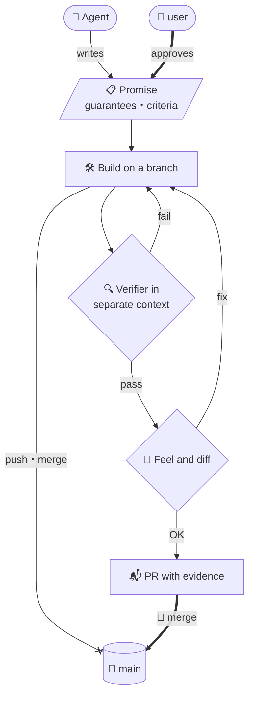
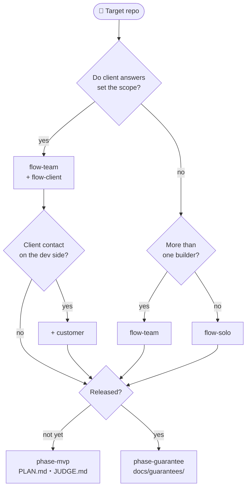

[🇯🇵 日本語](README.md) | [🇬🇧 English](README.en.md)

# sdlc-kit

This repository distributes conventions for developing with AI agents (Claude Code) — workflows, safeguards and documentation standards — as units you copy into an existing repository. It lets a whole team use a way of working that went well for one person, so that whoever takes the work leaves output and records of the same shape.

A working example of these conventions running in one person's environment is [dotfiles-public](https://github.com/yktsnet/dotfiles-public). Its implementation differs from the units here, for example by keeping issues as files inside the repository. The part that reads the output and records these conventions produce, and uses them for hiring, growth and reviews, is [mgmt-kit](https://github.com/yktsnet/mgmt-kit).

Documents in this repository linked from this page are in Japanese. External articles are marked individually.

| Without the conventions | With the conventions |
|---|---|
| Everyone asks differently, and output never looks the same | Output keeps its shape when the person changes |
| Why it was built that way and what was checked stay in one person's head | Agreements and checks stay in the repository as issues, PRs and the guarantee ledger |
| The agent checks its own work and lets its mistakes through | A verifier in a separate context checks against the agreed promises only |
| Only documents and human attention keep pushes and merges away from main | Hooks block them, and a person presses merge |

## Why

Once agents are running, the bottleneck moves from writing code to **verification** and **conveying intent**.

Verification is the time spent deciding whether what was written can be trusted. Agents make mistakes while staying confident, and left alone they let both errors and destructive operations through. Conveying intent breaks down because the agent fills unstated conditions by inference and finishes something that works. Because it works, nobody notices there was a gap.

On top of that, "what was promised", "who approved it" and "what was checked before calling it done" never make it into the code. One person can keep that in their head, but once more people build, it cannot be shared, and with a client you also have to track questions waiting on their answers. Even working alone, the you who rereads it months later is a different reader.

So this kit distributes places and procedures for keeping the trail of agreement and verification inside the repository, in forms you choose by who you build with (alone, as a team, or with a client).

## Principles

Only three things become conventions: the ones an agent cannot get past on its own. Writing code or summarizing a change is something you can simply ask for in the moment.

| Principle | What becomes a convention | Main units |
|---|---|---|
| **Do not let points that need human judgment drop** | Approving guarantees, declaring completion criteria, merging | Workflows, `guards` |
| **Keep things beyond the session** | Driving documents, issues, the guarantee ledger | Driving documents, workflows |
| **Stay consistent when the person changes** | Writing style, branch and PR handling, where things go, daily reports | `doc-style`, `branch-pr`, `daily-report` |

Output in a consistent shape shows differences between people as differences in substance rather than format, so it also becomes material for measuring where each person stands. The reasons behind the three, and how the places for records are divided, are in [docs/design-philosophy.md](docs/design-philosophy.md).

## How it works

**user** in this README is a role name: the person who decides what to build, approves guarantees and presses merge. When building as a team, besides the user there is an agent that designs issues (the **consultant**) and an agent that implements from an issue (the **executor**), kept separate ([roles.md](units/flow-team/docs/ops/roles.md)). When building alone, only an agent working in the same session as the user (the **implementer**) joins.

In every workflow, one change reaches main like this.



Thick lines are the user's actions; lines ending in `x` are paths the hooks reject.

The promise lives in the PR description for solo, and in a GitHub issue for team and client. The verifier is not given the builder's explanation and judges against the promise only. In solo it runs just before the PR is opened; in team it runs right after implementation. What the user looks at is how it feels to use and whether to accept anything that departs from the promise; checking behavior is left to the verifier and the tests.

## Quick Start

```bash
git clone https://github.com/yktsnet/sdlc-kit.git
cd <target repository>
for u in doc-style guards branch-pr flow-solo phase-mvp; do
  cp -R <path to sdlc-kit>/units/$u/. .
done
```

This example is the set for a repository one person is starting. For a team, replace `flow-solo` with `flow-team`; if already released, replace `phase-mvp` with `phase-guarantee`. Which to choose is decided in the Units section.

After copying, do three things: merge the settings snippets, fill in the `<...>` fields, and add references in `CLAUDE.md`. The steps are in [the "取り込んだあと" (after importing) section of units/README.md](units/README.md#取り込んだあと).

## Usage

After importing, you move forward by calling skills in Claude Code. In solo, pass what you want in one line and it starts by declaring completion criteria.

```text
> /work 同じ部屋で時間が重なる予約を受け付けないようにしたい
> /hand-off
```

(The example asks to reject bookings that overlap in time for the same room.) `/work` handles declaration, approval, implementation and the commit; `/hand-off` handles the verifier's judgment and opening the PR. In team, the consultant's session calls `/issue-draft` to file an issue, and once the user approves it, the executor's session calls `/issue-work <issue number>`.

## Units

The features are split into units. Apart from the base that every setup includes, you choose by who you build with and which period of development you are in.

### Always include

The base that keeps the discipline; included with every setup.

- **`doc-style`**: Standards for writing documents and comments, plus roles that proofread and review in a context separate from the writer
- **`guards`**: Safeguards that mechanically reject direct pushes to `main`, force pushes and `gh pr merge`
- **`branch-pr`**: Rules for branches and PRs, plus a hook that cleans up merged branches

### Who you build with, and which period

Pick one of the three workflows, and switch driving documents by period. They are separate axes and combine freely.



- **Workflows**: In this README, `flow-solo` is called solo, `flow-team` is team, and `flow-team` with `flow-client` on top is client. Client builds on team even when one person develops. Differences and signals for switching are in [docs/task-flows.md](docs/task-flows.md)
- **`customer`**: Add on top of client when someone on the development side decides requirements and acts as the client's contact (the **customer liaison**). It brings procedures for drawing requirements out of the field and prototypes, and skills for sending questions to the client and collecting answers
- **Driving documents**: The documents that drive development in a given period and keep being updated. When they hand over is in [docs/lifecycle.md](docs/lifecycle.md)

### Add when needed

Combine with any workflow, or install on their own.

- **`daily-report`**: Writes a daily report from pushed commits for stakeholders who do not follow issues or PRs
- **`walkthrough`**: When a core feature is finished, turns its inputs, outputs and decisions into one explainer
- **`grasp`**: Summarizes who uses the app and how, and how features connect, as an overview for people new to it
- **`secret-guard`**: Reduces passwords and API keys reaching GitHub, with a local hook and gitleaks in CI

## Design Decisions

- **Approve the promises first (Guarantee-Driven Development)**: People approve the guarantees on behavior; the agent writes the tests and the code. If TDD is the discipline of writing tests first, GDD is the discipline of approving promises first. Decided afterward, the promise bends to fit whatever was built ([Zenn: Guarantee-Driven Development](https://zenn.dev/yktsnet/articles/202608-guarantee-driven-development), Japanese)
- **Separate the role that decides from the role that builds**: In a team, the consultant who designs issues and the executor who implements them work in separate sessions, so the promise is not rewritten to suit the implementation
- **Put prohibitions in mechanisms**: A prohibition written in a document stops being followed the moment the reader's attention drops. Hooks and deny rules block it, and the rejection message points to the right path
- **Do not hand what can be checked deterministically to the agent's review**: An agent's review can judge the same input differently
- **Distribute by copying**: People without the source repository can still reproduce the procedures. Once imported, the units belong to that repository, and changes at the source do not arrive automatically

The other rules and the reasons for each are in the "だから守ること" (what to keep) section of docs/design-philosophy.md.

## Scope

- The mechanisms live in Claude Code's `.claude/` (settings deny rules, hooks, skills, subagents). With other agents the documents can still be read, but the blocking and the verifiers do not work
- Team and client assume GitHub issues and PRs, and `gh`. Other hosting services need the procedures rewritten
- The `doc-style` standards target documents written in Japanese
- Things tied to a machine (consistent tooling, distributing rules to every session, the secret mapping tables) cannot be distributed from a team repository, so they are not included. They live on the dotfiles-public side

## Docs

| Document | Contents |
|---|---|
| [docs/task-flows.md](docs/task-flows.md) | Differences between the three workflows, how to choose, signals for switching |
| [docs/flows/](docs/flows/) | One feature taken through a full cycle in solo, team and client |
| [docs/lifecycle.md](docs/lifecycle.md) | The two driving documents and when they hand over |
| [docs/design-philosophy.md](docs/design-philosophy.md) | What becomes a convention, how records are placed, order of adoption, rules to keep |
| [units/README.md](units/README.md) | Contents of each unit, what to do after importing, adding a unit |

## License

MIT
