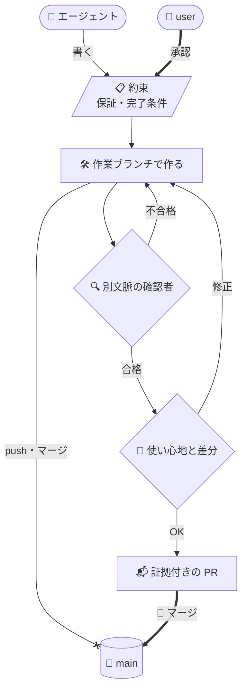
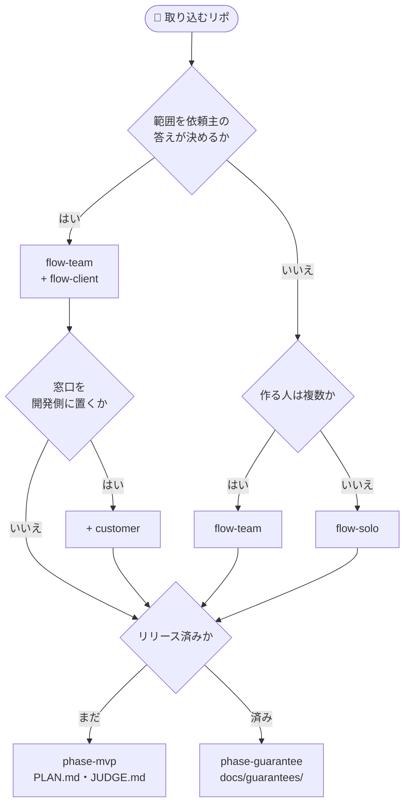

# sdlc-kit

本リポジトリは、AI エージェント（Claude Code）と開発するための型（ワークフロー・安全機構・文書規範）を、既存のリポジトリへコピーで取り込める単位として配る。1人がうまく回した進め方をチームの誰もが使えるようにし、誰が担当しても同じ形の成果物と記録が残るようにする。

この型を1人の開発環境で回している実例が [dotfiles-public](https://github.com/yktsnet/dotfiles-public) にある。Issue をリポジトリ内のファイルに置くなど、配る単位とは実装が異なる。この型で揃った成果物と記録を読み、採用・育成・評価に使う部分は [mgmt-kit](https://github.com/yktsnet/mgmt-kit) が受け持つ。

| 型が無いと | 型を入れると |
|---|---|
| 頼み方が人ごとに違い、成果物の形が揃わない | 担当が替わっても、同じ形の成果物が出る |
| なぜそう作ったか、何を確かめたかが、作業した人の頭にしか残らない | 合意と確認の記録が、Issue・PR・保証台帳としてリポジトリに残る |
| エージェントが自分の実装を自分で確かめ、誤りごと通す | 別のコンテキストの確認者が、約束だけを基準に確かめる |
| main への push やマージを止めるのが、文書と人の注意だけ | フックが止め、マージは人が押す |

---

## Why

エージェントを走らせると、ボトルネックはコード生成から**検証**と**意図伝達**へ移る。

検証では書かれたものを信じてよいかを確かめることに時間がかかる。エージェントは自信を持ったまま間違え、放っておけば誤りも破壊的な操作もそのまま通す。意図伝達では依頼に書かれていない条件をエージェントが推論で埋め、動くものを仕上げてしまう。動くので、空白があったことに気づきにくい。

しかも「何を約束したか」「誰が承認したか」「何を確かめて完了としたか」はコードに残らない。1人なら頭の中で足りるが、作る人が増えると共有できず、依頼主がいれば答えを待つ問いまで追うことになる。1人でも、数か月後に読み返す自分は別の読み手である。

そこで本キットは合意と検証の軌跡をリポジトリ内に残す置き場と手順を、誰と作るか（1人・チーム・依頼主あり）に合わせて選べる形で配る。

## Principles

型にするのは、エージェントが自力で越えられない次の3つだけである。コードを書く、変更点を要約するといった作業は、その場で頼めば足りる。

| 原則 | 型にするもの | 主な単位 |
|---|---|---|
| **人が判断すべき点を落とさせない** | 保証の承認、完了条件の宣言、マージ | 作業フロー、`guards` |
| **セッションを越えて残す** | 駆動文書、Issue、保証台帳 | 駆動文書、作業フロー |
| **担当者が替わっても揃う** | 文体、ブランチと PR の扱い、置き場の規則、日報 | `doc-style`、`branch-pr`、`daily-report` |

揃った成果物は、人ごとの差を書式ではなく中身の差として見せるので、現在地を測る材料にもなる。3つの理由と、置き場の分け方は [docs/design-philosophy.md](docs/design-philosophy.md) にある。

## How it works

どの作業フローでも、変更1本は次の形で main に入る。



太線は user の操作、`x` で終わる線はフックが拒否する経路を表す。

約束を置く場所は solo なら PR 本文、team と client なら GitHub Issue である。確認者には作った側の説明を渡さず、約束だけを基準に判定させる。solo では PR を出す直前に、team では実装を終えた直後に走る。user が見るのは使い心地と、約束から外れたものを採るかどうかで、挙動の照合は確認者とテストが受け持つ。

## Quick Start

```bash
git clone https://github.com/yktsnet/sdlc-kit.git
cd <取り込み先のリポジトリ>
for u in doc-style guards branch-pr flow-solo phase-mvp; do
  cp -R <sdlc-kit のパス>/units/$u/. .
done
```

例は1人で立ち上げるリポジトリの組み合わせである。チームなら `flow-solo` を `flow-team` に、リリース済みなら `phase-mvp` を `phase-guarantee` に替える。どれを選ぶかは次の Units 節で決める。

コピーしたら、settings の snippet のマージ、`<...>` の欄の記入、`CLAUDE.md` への参照の3つを済ませる。手順は [units/README.md の「取り込んだあと」](units/README.md#取り込んだあと) にある。

---

## Units

導入する機能は「単位（Unit）」に切り出してある。どの構成でも入れる基盤のほかは、誰と作るかと、開発のどの時期かで選ぶ。

### 常に入れる

規律を保つ基盤として、どの構成でも一緒に入れる。

- **`doc-style`**: 文書とコメントの書き方の規範と、書き手とは別のコンテキストで校正・点検する役
- **`guards`**: `main` への直接 push、force push、`gh pr merge` を機械的に拒否する安全機構
- **`branch-pr`**: ブランチと PR の運用規約と、マージ済みブランチを片付けるフック

### 誰と作るか・どの時期か

作業フローは3つから1つ選び、駆動文書は時期で替える。2つは別の軸で、どの組み合わせでもよい。



- **作業フロー**: 文中では `flow-solo` を solo、`flow-team` を team、`flow-client` を重ねたものを client と呼ぶ。client は開発側が1人でも team を土台にする。違いと乗り換える合図は [docs/task-flows.md](docs/task-flows.md) にある
- **`customer`**: client で、要件を決めて依頼主の窓口を務める人（**顧客理解担当**）を開発側に置くなら重ねる。現場と試作から要件を引き出す手順と、依頼主への照会と回収の skill が入る
- **駆動文書**: その時期の開発を進め、更新され続ける文書を指す。交代する時期は [docs/lifecycle.md](docs/lifecycle.md) にある

文中の **user** は役名で、何を作るかを決め、保証を承認し、マージを押す人を指す。チームで作る場合は、user のほかに Issue を設計するエージェント（**相談者**）と、Issue に基づいて実装するエージェント（**実行者**）を分ける（[roles.md](units/flow-team/docs/ops/roles.md)）。1人で作る場合は、user と同じセッションで作るエージェント（**実装者**）だけが加わる。

### 必要なら足す

どの作業フローとも組め、単独でも入れられる。

- **`daily-report`**: push 済みのコミットから、Issue や PR を追わない関係者向けの日報を書く
- **`walkthrough`**: 中核の機能を作り終えたときに、その入出力と判断を1本の解説書にする
- **`grasp`**: アプリが誰にどう使われ、機能どうしがどうつながるかを、初めて触る人向けの概要資料にまとめる
- **`secret-guard`**: パスワードや API キーが GitHub に届くのを、手元のフックと CI の gitleaks で減らす

---

## Design Decisions

- **約束を先に承認する（Guarantee-Driven Development）**: 振る舞いの保証は人が承認し、テストと実装はエージェントが書く。TDD がテストを先に書く規律なら、GDD は約束を先に承認する規律である。後から決めると、できたものに合わせた約束になる（[Zenn: 保証駆動開発](https://zenn.dev/yktsnet/articles/202608-guarantee-driven-development)）
- **決める役と作る役を分ける**: チームで作る場合、Issue を設計する相談者と実装する実行者を別のセッションにする。実装の都合で約束を書き換えさせない
- **禁止は機構に置く**: 文書に書いた禁止は、読み手の集中力が落ちた時点で守られなくなる。フックと deny で遮断し、拒否メッセージで正しい経路へ誘導する
- **決定的に確かめられるものはエージェントの点検に回さない**: エージェントの点検は同じ入力でも判定が変わることがある
- **コピーで配る**: 配布元を持たない人も手順を再現できる。取り込んだ時点でそのリポジトリの持ち物になり、配布元の変更は自動では届かない

ほかの規範と、それぞれの理由は docs/design-philosophy.md の「だから守ること」にある。

## Scope

- 機構は Claude Code の `.claude/`（settings の deny、フック、skill、subagent）に置いている。ほかのエージェントでは、規範の文書は読めても遮断と確認者は働かない
- team と client は GitHub の Issue と PR、`gh` を前提にしている。ほかのホスティングでは手順を書き換える必要がある
- `doc-style` の規範は日本語の文書を対象にしている
- 端末に紐づくもの（道具の統一、規則の全セッションへの配布、機密の対応表）はチームのリポジトリからは配れないので含めていない。それらは dotfiles-public の側にある

## Docs

| 文書 | 中身 |
|---|---|
| [docs/task-flows.md](docs/task-flows.md) | 3つの作業フローの違い、選び方、乗り換える合図 |
| [docs/flows/](docs/flows/) | 同じ機能を solo・team・client で1周させた案内 |
| [docs/lifecycle.md](docs/lifecycle.md) | 2つの駆動文書と、交代する時期 |
| [docs/design-philosophy.md](docs/design-philosophy.md) | 何を型にするか、置き場の分け方、導入の順序、守ること |
| [units/README.md](units/README.md) | 単位ごとの中身、取り込んだあとにやること、単位を足すとき |

## License

MIT
