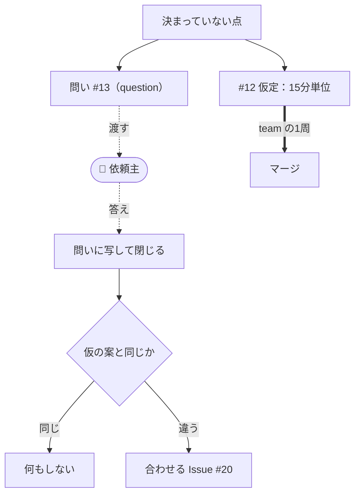

# client の回し方

作る範囲を開発の外にいる依頼主の答えが決める場合の回し方を、[team](team.md) との差分だけで示す。
題材は同じ会議室予約アプリで、総務部から受けた案件とする。導入した先で守る規約は
`units/flow-client/docs/ops/client.md` にある。

team では作業を止めるのは実装である。依頼主がいると、作業を止めるのは答えになり、答えは開発側の
都合では早まらない。そこで、**答えを待たずに仮の案で作り、何を仮に置いたかを残す**。

## 足すもの

- **問いの Issue**: 依頼主に聞くことを、`question` ラベルの Issue として立てる。1つの問いに1つの Issue
- **仮定**: 作業の Issue の `仮定` 欄に、仮に置いた案と問いの Issue の番号を書く
- skill `client-next`: 問いを立てる、届いた答えを回収する、次に着手する Issue を選ぶ

## 1つの問いの流れ



点線は開発の外とのやりとりを表す。作業の Issue（太線）は答えを待たずに進む。

### 1. 決まっていない点に気づく

相談者は #12「同じ部屋で時間帯が重なる予約を拒否する」を起票するときに、要件定義書に時間の刻みが
書かれていないことに気づく。

```text
$ rg -n '分単位|刻み|interval' docs/
$ rg -n 'start|end' docs/requirements.md
docs/requirements.md:58:- 予約は開始日時と終了日時を持つ
```

刻みが決まらないと、重なりの判定に使う時刻の丸め方が決まらない。決めるのは依頼主である。

### 2. 問いを立て、仮の案で起票する

相談者は `client-next` で問いの Issue を立てる。

```text
> /client-next 予約の時間の刻みを総務部に聞きたい
$ gh issue create --label question --title "予約の時間は15分刻みで区切りますか" --body-file -
https://github.com/example/room-booking/issues/13
```

```markdown
問い: 予約の開始と終了の時刻は15分刻みに限りますか
選択肢: 15分刻み / 5分刻み / 1分単位（自由）
仮の案: 15分刻み。現在の紙の予約表が15分の升目で、重なりの判定も単純になるため
掛かる Issue: #12
期限: 11/14。予約画面の作成（#15）に着手する時点で、入力欄の刻みが決まっている必要がある
```

続けて #12 の `仮定` に、仮の案と問いの番号を書く。

```markdown
仮定: 時間帯は半開区間とする（10:00-11:00 と 11:00-12:00 は重ならない）。
      開始と終了は15分刻みに限り、それ以外は 422 で拒否する（#13 の答え待ち）
```

#12 は答えを待たずに裁可を受け、team と同じ1周でマージまで進む。

### 3. 問いを依頼主に渡す

user は総務部の担当者に、問いの Issue の本文をそのまま送る。経路はメールでも打ち合わせでもよい。

```text
件名: 【会議室予約】予約の時間の刻みについて（#13）

総務部 ご担当者様

予約の開始と終了の時刻を15分刻みに限るかどうかを、ご確認ください。
  1. 15分刻み  2. 5分刻み  3. 1分単位（自由）

いまは1で作っています。11/14 までにお返事がなければ、予約画面も1で作ります。
```

### 4. 答えを写して閉じる

答えを受け取った人は、答えをそのまま問いの Issue のコメントに写して閉じる。**答えの正本は問いの
Issue に置く**。メールの中にしか無い答えは、次に作業する人には見えない。

```text
$ gh issue comment 13 --body "総務部より（11/10 メール）: 5分刻みにしてほしい。15分では打ち合わせの前後の移動時間を取りにくい。"
$ gh issue close 13
```

### 5. 答えを回収する

相談者は `client-next` で、閉じた問いと仮の案を突き合わせる。

```text
> /client-next 答えを回収して

回収した問い:
  #13 予約の時間は15分刻みで区切りますか
      答え: 5分刻み / 仮の案: 15分刻み → 違う
      掛かる Issue:
        #12（closed）→ 開き直さず、答えに合わせる #20 を draft で起票した
        #15（open・未着手）→ 本文の「入力欄は15分刻み」を「5分刻み」に直し、draft を付け直した
```

閉じた #12 を開き直さないのは、何を裁可して作ったかを後から読めるようにするためである。まだ着手して
いない #15 は、本文を直して裁可を受け直せば足りる。答えが仮の案と同じなら、作業の Issue にその旨を
コメントするだけで済む。

## 次に着手するものを選ぶ

`client-next` は答え待ちの問いに掛かっていない Issue を先に並べる。掛かっているものにも着手してよいが、
どの答えでやり直しになりうるかを添える。

```text
> /client-next 次は何をやる？

答え待ちの問い:
  #17 予約の取り消しは開始の何分前まで受け付けますか（期限 11/21）

着手できる Issue:
  1. #20 予約の時刻を5分刻みに直す
  2. #16 予約画面に週表示を足す
  3. #18 予約の取り消しを開始前に限る ← #17 の答えでやり直しになりうる
```

## 依頼主に見せる現在地

依頼主が知りたいのは、何ができていて、何が自分の答え待ちかである。どちらも一覧で答えられる。

- できたもの: 閉じた作業の Issue のうち、開いている問いに掛かっていないもの
- 答え待ち: 開いている `question` の Issue と、それぞれに掛かっている作業の Issue

```text
$ gh issue list --label question
#17  予約の取り消しは開始の何分前まで受け付けますか    question
$ gh issue list --state closed --search "-label:question"
#11  予約を部屋ごとに一覧できるようにする
#12  同じ部屋で時間帯が重なる予約を拒否する
```

#18 が閉じても、#17 が開いているうちは「できたもの」に入らない。
