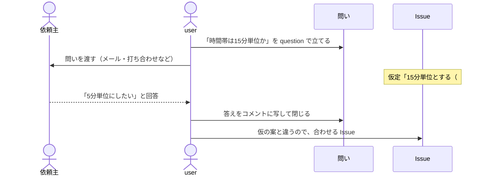

# client の回し方

作る範囲を開発の外にいる依頼主の答えが決める場合の回し方を、[team](team.md) との差分だけで示す。
題材は同じ会議室予約アプリである。導入した先で守る規約は `units/flow-client/docs/ops/client.md` にある。

team では、作業を止めるのは実装である。依頼主がいると、作業を止めるのは答えになり、答えは開発側の
都合では早まらない。そこで、**答えを待たずに仮の案で作り、何を仮に置いたかを残す。**

## 足すもの

- **問いの Issue**: 依頼主に聞くことを、`question` ラベルの Issue として立てる。1つの問いに1つの Issue
- **仮定**: 作業の Issue の `仮定` 欄に、仮に置いた案と問いの Issue の番号を書く
- skill `client-next`: 届いた答えを回収し、次に着手する Issue を選ぶ

## 1つの問いの流れ

二重予約を拒否する Issue #12 を起票するとき、相談者は「予約の時間帯は15分単位か、自由か」が
決まっていないことに気づく。重なりの判定に関わるが、決めるのは依頼主である。



問いの Issue の本文は次の形である。

```text
問い: 予約の時間帯は15分単位で区切りますか
選択肢: 15分単位 / 5分単位 / 自由
仮の案: 15分単位。会議室予約で多く、重なり判定が単純になるため
掛かる Issue: #12
期限: 予約画面の作成（#15）に着手する時点
```

答えが仮の案と同じなら、何もしなくてよい。違えば、閉じた #12 を開き直さず、答えに合わせる
新しい Issue を立てる。開き直すと、何を裁可して作ったかが後から読めなくなる。

依頼主とのやりとりの経路は問わないが、**答えの正本は問いの Issue に置く。** メールの中にしか無い答えは、
次に作業する人には見えない。

## 依頼主に見せる現在地

依頼主が知りたいのは、何ができていて、何が自分の答え待ちかである。どちらも一覧で答えられる。

- できたもの: 閉じた作業の Issue のうち、開いている問いに掛かっていないもの
- 答え待ち: 開いている `question` の Issue と、それぞれに掛かっている作業の Issue

#12 は閉じていても、#13 が開いているうちは「できたもの」に入らない。
