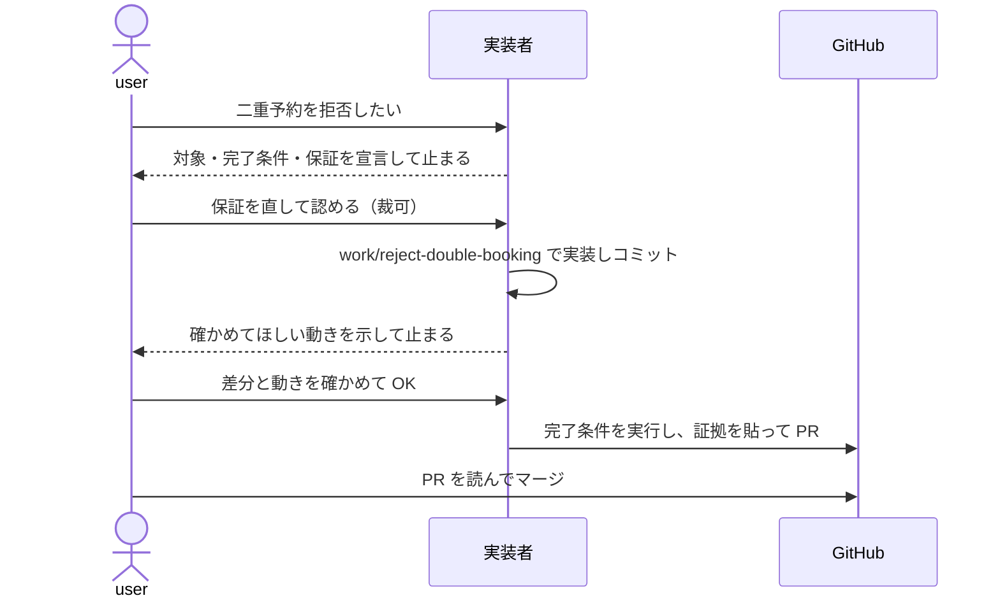

# solo の回し方

決める人と作る人が同じ1人で、エージェントと作る場合の1周を、例を通して示す。選び方は
[task-flows.md](../task-flows.md)、導入した先で守る規約は `units/flow-solo/docs/ops/workflow.md` にある。

例の題材は、会議室を予約する小さな Web アプリである。3つの案内（solo・team・client）は同じ題材と
同じ機能を使い、置き場と加わる人の違いだけが見えるようにしている。今回の機能は
「同じ部屋・同じ時間帯の二重予約を拒否する」である。

## 登場するもの

- **user**: 何を作るかを決め、エージェントの宣言を認め、マージを押す人
- **実装者**: user と同じセッションで作るエージェント。skill `work` と `hand-off` に従う
- **完了条件**: 何が真になれば終わりかを、実行して確かめられる形で書いたもの
- **保証**: この変更の後に成り立つべき振る舞い。テストで固定する

## 1周の流れ



### 1. 宣言

user が「二重予約を拒否したい」と頼むと、`work` は実装に入る前に次を示して止まる。

```text
対象: api/reservations.py, tests/test_reservations.py
完了条件:
  - pytest tests/test_reservations.py が通る
保証:
  - 新たに宣言: 同じ部屋で時間帯が重なる予約は 409 を返し、保存しない
  - 維持: 時間帯が接している予約（10:00-11:00 と 11:00-12:00）は両方とも受け付ける
```

先に止まるのは、作ってから条件を決めると、できたものに合わせて条件を書いてしまうからである。

### 2. 裁可

user は保証を読み、削る・足す・直す。ここでは「別の部屋なら同じ時間帯でも受け付ける」を維持の
保証に足した。**裁可するまで実装に入らない。** 裁可とは、この約束で作ってよいと user が認めることを指す。

### 3. 実装とレビュー

実装者は作業ブランチ `work/reject-double-booking` を切って実装し、ローカルのコミットで止まる。
user は `git diff main...work/reject-double-booking` を読み、重なる予約を手で入れて 409 が返るのを見る。
直す点があればその場で伝え、実装者が追加のコミットで直す。

### 4. 引き渡し

`hand-off` は完了条件を実際に実行し、出力を PR 本文に貼る。宣言した完了条件と保証は、
そのまま PR 本文に入る。

```markdown
## 完了条件
- pytest tests/test_reservations.py が通る

## 証拠
$ pytest tests/test_reservations.py
5 passed in 0.12s

## 保証
| 保証 | 対応テスト |
|---|---|
| 重なる予約は 409 で保存しない | `test_overlap_rejected` |
| 接している予約は両方受け付ける | `test_adjacent_accepted` |
| 別の部屋なら受け付ける | `test_other_room_accepted` |
```

### 5. マージ

user が PR を読んでマージする。エージェントはマージできない。`guards` のフックが `gh pr merge` を拒否する。

## 何が残るか

合意（完了条件と保証）、確かめた跡（証拠）、変更（コミット）が、すべて1本の PR に残る。
残作業の一覧は open な PR の一覧である。作る人が2人目になり、PR の一覧では誰が何を持っているかを
共有できなくなったら、[team](team.md) へ移る。
