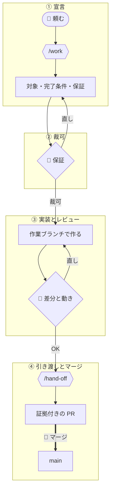

# solo の回し方

決める人と作る人が同じ1人で、エージェントと作る場合の1周を、例を通して示す。選び方は
[task-flows.md](../task-flows.md)、導入した先で守る規約は `units/flow-solo/docs/ops/workflow.md` にある。

例の題材は、会議室を予約する小さな Web アプリ（Python・FastAPI・SQLite）である。3つの案内
（solo・team・client）は同じ題材と同じ機能を使い、置き場と加わる人の違いだけが見えるようにしている。
今回の機能は「同じ部屋・同じ時間帯の二重予約を拒否する」である。

## 登場するもの

- **user**: 何を作るかを決め、エージェントの宣言を認め、マージを押す人
- **実装者**: user と同じセッションで作るエージェント。skill `work` と `hand-off` に従う
- **完了条件**: 何が真になれば終わりかを、実行して確かめられる形で書いたもの
- **保証**: この変更の後に成り立つべき振る舞い。テストで固定する

## 1周の流れ



| | 残すもの | 👤 user が判断すること |
|---|---|---|
| ① 宣言 | 対象・完了条件・対象外・仮定・保証 | — |
| ② 裁可 | 直した宣言 | この約束で作ってよいか |
| ③ 実装とレビュー | コミット（本文に完了条件と保証） | 差分と動きが宣言どおりか |
| ④ 引き渡しとマージ | PR（本文に証拠） | マージするか |

### ① 宣言

user は `work` を呼んで、やりたいことを1行で伝える。

```text
> /work 同じ部屋で時間が重なる予約を受け付けないようにしたい
```

実装者はコードを読み、実装に入る前に次を示して止まる。

```markdown
## 対象
- app/reservations.py
- tests/test_reservations.py

## 完了条件
- `pytest tests/test_reservations.py` がすべて通る
- 重なる予約を POST すると 409 と `{"detail": "room_already_booked"}` が返る

## 対象外
- 予約の編集（PATCH）での重なりの判定

## 仮定
- 時間帯は半開区間として扱う。10:00-11:00 と 11:00-12:00 は重ならない
- 同時に2件が届いたときの競合は扱わない。利用者は社内の数十人で、同時の POST はほぼ起きない

## 保証
- 新たに宣言する保証: 同じ部屋で時間帯が重なる予約は 409 を返し、保存しない
- 維持する保証: 時間帯が接している予約は両方とも受け付ける
```

先に止まるのは、作ってから条件を決めると、できたものに合わせて条件を書いてしまうからである。
`仮定` には実装者が user に聞かずに決めたことが並ぶ。聞かずに決めたことは、ここ以外に残らない。

### ② 裁可

user は保証・対象外・仮定を読み、削る・足す・直す。

```text
> 維持する保証に「別の部屋なら同じ時間帯でも受け付ける」を足して。
> 取り消した予約（status = "cancelled"）とは重ならない扱いにして、それも保証に入れて。
> 仮定はそのままでいい。
```

実装者は宣言を直して見せ直し、user が OK を出す。**裁可するまで実装に入らない**。裁可とは、
この約束で作ってよいと user が認めることを指す。

### ③ 実装とレビュー

実装者は作業ブランチ `work/reject-double-booking` を切り、テストと実装を書く。

```python
# tests/test_reservations.py
def test_overlap_rejected(client):
    book(client, room="A", start="10:00", end="11:00")
    res = book(client, room="A", start="10:30", end="11:30")
    assert res.status_code == 409
    assert res.json() == {"detail": "room_already_booked"}
    assert len(client.get("/reservations?room=A").json()) == 1

def test_adjacent_accepted(client):
    book(client, room="A", start="10:00", end="11:00")
    assert book(client, room="A", start="11:00", end="12:00").status_code == 201

def test_other_room_accepted(client):
    book(client, room="A", start="10:00", end="11:00")
    assert book(client, room="B", start="10:00", end="11:00").status_code == 201

def test_cancelled_does_not_block(client):
    rid = book(client, room="A", start="10:00", end="11:00").json()["id"]
    client.post(f"/reservations/{rid}/cancel")
    assert book(client, room="A", start="10:00", end="11:00").status_code == 201
```

```diff
# app/reservations.py
 @router.post("/reservations", status_code=201)
 def create_reservation(body: ReservationIn, db: Session = Depends(get_db)):
+    overlap = db.scalar(
+        select(Reservation).where(
+            Reservation.room == body.room,
+            Reservation.status != "cancelled",
+            Reservation.start < body.end,
+            body.start < Reservation.end,
+        )
+    )
+    if overlap:
+        raise HTTPException(status_code=409, detail="room_already_booked")
     reservation = Reservation(**body.model_dump())
```

コミットの本文には、裁可した完了条件と保証をそのまま入れる。④ で `hand-off` がこれを PR 本文の
下敷きにする。

```text
feat: reject overlapping reservations in the same room

## 完了条件
- `pytest tests/test_reservations.py` がすべて通る
- 重なる予約を POST すると 409 と {"detail": "room_already_booked"} が返る

## 保証
- 新たに宣言: 同じ部屋で時間帯が重なる予約は 409 を返し、保存しない
- 新たに宣言: 取り消した予約とは重ならない扱いにする
- 維持: 時間帯が接している予約は両方とも受け付ける
- 維持: 別の部屋なら同じ時間帯でも受け付ける
```

実装者は push せずに止まり、確かめてほしい動きと、実装で決めたことを並べる。

```text
work/reject-double-booking にコミットしました。差分は git diff main...work/reject-double-booking で見られます。

確かめてほしい動き:
  uvicorn app.main:app --reload を起動して、次の2つを順に送ってください。2つ目が 409 になれば正しい動きです。
    curl -s -XPOST localhost:8000/reservations -H 'content-type: application/json' \
      -d '{"room":"A","start":"2026-11-02T10:00","end":"2026-11-02T11:00"}'
    curl -s -XPOST localhost:8000/reservations -H 'content-type: application/json' \
      -d '{"room":"A","start":"2026-11-02T10:30","end":"2026-11-02T11:30"}'

実装で決めたこと:
  - 重なりの判定は「既存の start < 新規の end かつ 新規の start < 既存の end」にした
  - DB の排他制約は使わなかった。SQLite では時間帯の重なりを制約で表せないため
```

user は差分を読み、curl で 409 を確かめる。直す点があれば、同じセッションで伝える。

```text
> 409 のとき、ぶつかった予約の id も返して。画面で「どの予約と重なったか」を出したい。
```

実装者は完了条件の2つ目と `test_overlap_rejected` を直して追加のコミットを積み、③ の報告をやり直す。
この直しは宣言の範囲に収まるので、宣言から作り直す必要は無い。対象のファイルが増えるときは、
実装者が止まって宣言を作り直す。

### ④ 引き渡しとマージ

user が OK を出したら `hand-off` を呼ぶ。

```text
> /hand-off
```

`hand-off` は完了条件を実際に実行し、出力を要約せずに PR 本文へ貼る。

````markdown
## 変更内容

同じ部屋で時間帯が重なる予約を 409 で拒否する。取り消した予約は重なりに数えない。

## 完了条件

- `pytest tests/test_reservations.py` がすべて通る
- 重なる予約を POST すると 409 と、ぶつかった予約の id が返る

## 証拠

**`pytest tests/test_reservations.py` がすべて通る**

```
$ pytest tests/test_reservations.py -v
tests/test_reservations.py::test_create_reservation PASSED
tests/test_reservations.py::test_overlap_rejected PASSED
tests/test_reservations.py::test_adjacent_accepted PASSED
tests/test_reservations.py::test_other_room_accepted PASSED
tests/test_reservations.py::test_cancelled_does_not_block PASSED
5 passed in 0.31s
```

**重なる予約を POST すると 409 と、ぶつかった予約の id が返る**

```
$ curl -s -w ' %{http_code}' -XPOST localhost:8000/reservations -H 'content-type: application/json' \
    -d '{"room":"A","start":"2026-11-02T10:30","end":"2026-11-02T11:30"}'
{"detail":"room_already_booked","conflict_id":1} 409
```

## 保証

| 保証 | 対応テスト |
|---|---|
| 同じ部屋で重なる予約は 409 を返し、保存しない | `test_overlap_rejected` |
| 取り消した予約とは重ならない扱いにする | `test_cancelled_does_not_block` |
| 時間帯が接している予約は両方とも受け付ける | `test_adjacent_accepted` |
| 別の部屋なら同じ時間帯でも受け付ける | `test_other_room_accepted` |

## 検証手順

1. 予約画面で、会議室 A の 11/2 10:00-11:00 を予約する
2. 同じ部屋の 10:30-11:30 を予約し、「この時間は予約済みです」が出ることを見る
````

画面での確認は実装者には終えられないので、`## 証拠` ではなく `## 検証手順` に回る。ここで
「確認済み」とは書かない。完了条件のどれかを裏付けられなければ、`hand-off` は PR を立てずに止まる。

user は PR を読み、検証手順を踏んでからマージする。エージェントはマージできない。実装者が
`gh pr merge` を打つと、`guards` のフックが拒否し、理由をエージェントに返す。

```text
● Bash(gh pr merge 31 --squash)
  ⎿  Denied: PR のマージは user が行う。実装者はレビューへ渡すところまでで止まること（引き渡し手順は docs/ops/workflow.md）。
```

## 何が残るか

合意（完了条件と保証）、確かめた跡（証拠）、変更（コミット）がすべて1本の PR に残る。
後から「なぜ cancelled を除いたか」を知りたくなったら、PR を開けば裁可した保証とテストの対応が読める。
残作業の一覧は open な PR の一覧である。

```text
$ gh pr list
#33  work/booking-calendar-view    予約画面に週表示を足す
#32  work/room-capacity            部屋の定員を超える予約を拒否する
```

作る人が2人目になり、PR の一覧では誰が何を持っているかを共有できなくなったら、[team](team.md) へ移る。
