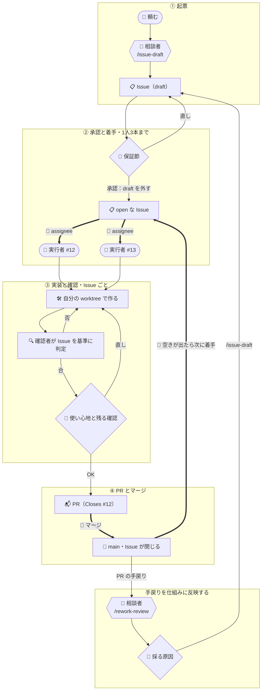

# team の回し方

作る人が複数いる場合の1周を、[solo](solo.md) と同じ「二重予約を拒否する」で示す。選び方は
[task-flows.md](../task-flows.md)、導入した先で守る規約は `units/flow-team/docs/ops/` にある。

solo との違いは合意を PR より前の GitHub Issue に置くことと、決める役と作る役を分けることである。
誰が何を持っているか、何が承認済みかを、作る人どうしで Issue の一覧から読めるようにする。

## 三役

| 役 | すること | しないこと |
|---|---|---|
| **user** | 保証の承認、着手、レビュー、マージ | — |
| **相談者** | 調べて Issue を設計し、起票する（skill `issue-draft`） | 実装 |
| **実行者** | Issue に基づいて実装し、PR を出す（skill `issue-work`） | main への push、マージ |

相談者と実行者はどちらもエージェントで、別のセッションで動く。相談者は main のチェックアウトで、
実行者は Issue ごとの作業ブランチで動く。決める場と作る場を分けるのは、実装の都合で約束を
書き換えさせないためである。

## 1周の流れ



| | 残すもの | 次に読む人 | 👤 user が判断すること |
|---|---|---|---|
| ① 起票 | Issue の本文（`draft` ラベル付き） | user | — |
| ② 承認と着手 | `draft` を外した Issue、assignee | 実行者、ほかの作り手 | この約束で作ってよいか |
| ③ 実装と確認 | コミット（本文に保証とテストの対応）、確認者の判定 | user | 使い心地と、確認者が判定できなかったもの |
| ④ PR とマージ | PR（`Closes #12`、手戻り） | user、相談者の `rework-review` | マージするか、繰り返す手戻りのどれを Issue にするか |

### ① 起票（相談者）

user は main のチェックアウトで開いた相談者に頼む。

```text
> /issue-draft 同じ部屋で時間が重なる予約を受け付けないようにしたい
```

相談者は書く前に、作業の主な語でリポ全体と過去の Issue を検索し、当たった資料を全文読む。今回は
要件の `docs/spec.md` 2.3 節と、取り消しを入れた #7、作業中の #10（予約の時間変更）が当たった。
#10 が同じ関数を書き換えるなら `待ち: #10` と書くところだが、別の関数を直しているので `なし` にする。
相談者は `draft` ラベルを付けて #12 を起票し、止まる。user が読むのは次の本文である。

```markdown
slug: reject-double-booking
type: feat
対象: app/reservations.py, tests/test_reservations.py, docs/api.md
目的: 同じ部屋に重なる予約が入り、利用者が現地で鉢合わせることを無くす。
      docs/spec.md 2.3 の「有効な予約は1件しか存在しない」を API で守らせる
内容: POST /reservations で、同じ部屋の有効な予約と時間帯が重なる予約を 409 で拒否する
対象外: 予約の時間変更（#10 の PATCH）での重なりの判定。#10 のマージ後に別 Issue にする
仮定: 時間帯は半開区間とする（10:00-11:00 と 11:00-12:00 は重ならない）。
      取り消した予約（status = "cancelled"）は「有効な予約」に含めない
確認: pytest tests/ がすべて通る。ruff check app/ が通る
根拠: "overlap" "重な" "double" で app/ と docs/ を検索。docs/spec.md 2.3 を全文。
      "予約 重複" で Issue を検索し、#7（取り消し）と #10（時間変更、作業中）を読んだ
待ち: なし

---

### 保証
- 新たに宣言する保証:
  - 同じ部屋で時間帯が重なる有効な予約があれば、409 を返し、保存しない
  - 取り消した予約とは重ならない扱いにする
- 維持する保証:
  - 時間帯が接している予約は両方とも受け付ける
  - 別の部屋なら同じ時間帯でも受け付ける
```

**保証節** は、solo の保証と同じものを Issue の中に置いた節である。`対象外` と `仮定` を書かせるのは、
相談者が user に聞かずに決めたことを、そこ以外に残す場所が無いからである。`docs/api.md` を `対象` に
入れているのは、振る舞いを説明する文書を実装と同じ PR で直すためである。

### ② 承認と着手（user）

user は保証節・`対象外`・`仮定` を読み、GitHub 上で本文を直す。今回は 409 の応答にぶつかった予約の
id を返す保証を足した。直し終えたら `draft` ラベルを外す。**`draft` の無い open な Issue は、承認済みという意味になる**。

着手の前に、assignee の付いた Issue とぶつからないかを見る。今回は alice が #13（部屋の定員）を
作業中だが、定員の判定は重なりの判定と別の関数なので、並べて進められる。

着手するときは、自分を assignee に付け、Issue ごとの worktree に作業ブランチを切り、そこで新しく開いた
Claude Code に実行者として Issue 番号を渡す。

```text
$ gh issue edit 12 --remove-label draft
$ gh issue edit 12 --add-assignee @me
$ git worktree add ../room-booking.wt/12-reject-double-booking -b issue/12-reject-double-booking origin/main
$ cd ../room-booking.wt/12-reject-double-booking && claude
> /issue-work 12
```

相談者の会話は引き継がない。実行者は Issue だけを読んで始めるので、Issue に書いていないことは伝わらない。

### ③ 実装と確認（実行者と user）

実行者は実装の前に Issue の語でリポを検索し直す。`根拠` に無い資料が見つかれば、手を付ける前に
「新しい Issue にする・この Issue の中で直す・見送る」のどれにするかを user に聞く。今回は README の
応答例が見つかり、user は同じ PR で直すことにした。実行者は #12 の `対象` に `README.md` を書き足してから
実装に入る。コミットの前に、差分のファイルと `対象` を突き合わせるからである。

実行者はコミットしたら、確認者（`issue-verifier`）に Issue 番号と worktree のパスだけを渡す。確認者は
実行者の説明を受け取らず、Issue の `確認` と保証節を自分で実行し、`対象` と差分を突き合わせて合否と証拠を返す。
確認者を置く理由は `units/flow-team/docs/ops/roles.md` の「確認者」にある。「否」があれば実行者が直し、判定を受け直す。

「否」が無くなると、実行者は判定の表と、確認者が判定できなかったもの（今回は予約画面での表示）を示して止まる。
user は挙動の照合を繰り返さず、使い心地と残った確認を見る。直す点は同じセッションで伝え、指摘のために別の Issue は立てない。

### ④ PR とマージ

user が OK を出すと、実行者は main を取り込み、確認をやり直してから自分のブランチを push し、本文の先頭に
`Closes #12` を置いた PR を出す。user が PR を読んでマージすると、#12 が閉じる。実行者は main への push も
マージもできない。PR を出したら、user は実行者のセッションを閉じて worktree を消す。マージで
受け持ちが1本空くので、user は一覧から次の Issue に着手できる。

PR 本文の末尾には `## 手戻り` を置く。今回は確認者が取り消した予約の扱いを「否」とし、実行者が1回直したので、
その1行が残る。繰り返す原因は、相談者が `rework-review` で束ねて Issue にする。何を書くかと原因の分類は
`units/flow-team/docs/ops/workflow.md`「手戻りを記録し、仕組みへ返す」にある。

保証台帳（`docs/guarantees.md`、`phase-guarantee` を入れたリポだけ）があれば、起票のときに台帳を
`対象` に入れておき、同じ PR で #12 の保証節を台帳に足す。

マージの後に問題が出たら、#12 を開き直さず、#12 を本文で指す新しい Issue を立てる。理由は
`units/flow-team/docs/ops/workflow.md`「派生 Issue」にある。

## 一覧から読めること

状態はラベルと assignee で見分ける。見分け方の表は `units/flow-team/docs/ops/workflow.md`「一覧の読み方」にある。

```text
$ gh issue list
#16  予約画面に週表示を足す                     draft
#15  予約の時間変更でも重なりを拒否する
#13  部屋の定員を超える予約を拒否する                   alice
#12  同じ部屋で時間帯が重なる予約を拒否する             bob
```

この一覧なら、#16 は承認待ち、#13 と #12 は作業中と読める。#15 は `draft` も assignee も無いが、
#12 の重なりの判定を時間変更にも使うので、本文の `待ち` に #12 があり、着手できるのは #12 のマージの後になる。
assignee の違う #13 と #12 は並行して進む。並行して進める決まりは
`units/flow-team/docs/ops/workflow.md`「並行して動かす」にある。

依頼主の答えを待つ問いが積み上がってきたら、[client](client.md) を重ねる。
