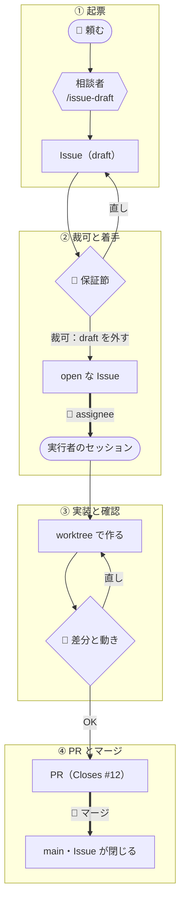

# team の回し方

作る人が複数いる場合の1周を、[solo](solo.md) と同じ「二重予約を拒否する」で示す。選び方は
[task-flows.md](../task-flows.md)、導入した先で守る規約は `units/flow-team/docs/ops/` にある。

solo との違いは合意を PR より前の GitHub Issue に置くことと、決める役と作る役を分けることである。
誰が何を持っているか、何が裁可済みかを、作る人どうしで Issue の一覧から読めるようにする。

## 三役

| 役 | すること | しないこと |
|---|---|---|
| **user** | 保証の裁可、着手、レビュー、マージ | — |
| **相談者** | 調べて Issue を設計し、起票する（skill `issue-draft`） | 実装 |
| **実行者** | Issue に基づいて実装し、PR を出す（skill `issue-work`） | main への push、マージ |

相談者と実行者はどちらもエージェントで、別のセッションで動く。相談者は main のチェックアウトで、
実行者は Issue ごとの作業ブランチで動く。決める場と作る場を分けるのは、実装の都合で約束を
書き換えさせないためである。

## 1周の流れ



| | 残すもの | 次に読む人 | 👤 user が判断すること |
|---|---|---|---|
| ① 起票 | Issue の本文（`draft` ラベル付き） | user | — |
| ② 裁可と着手 | `draft` を外した Issue、assignee | 実行者、ほかの作り手 | この約束で作ってよいか |
| ③ 実装と確認 | コミット（本文に保証とテストの対応） | user | 差分と動きが Issue どおりか |
| ④ PR とマージ | PR（`Closes #12`） | user | マージするか |

### ① 起票（相談者）

user は main のチェックアウトで開いた相談者に頼む。

```text
> /issue-draft 同じ部屋で時間が重なる予約を受け付けないようにしたい
```

相談者は書く前に、作業の主な語でリポ全体と過去の Issue を検索し、当たった資料を全文読む。

```text
$ rg -n -i 'overlap|重な|double' app/ docs/
docs/spec.md:41:### 2.3 予約の一意性
docs/spec.md:43:同じ部屋の同じ時間帯に、有効な予約は1件しか存在しない。
$ gh issue list --state all --search "予約 重複 in:title,body"
#10  OPEN   予約の時間を変更できるようにする   (assignee: alice)
#7   CLOSED 予約を取り消せるようにする
```

#10 は作業中で、同じ `create_reservation` の近くを書き換える。相談者は `#10` の差分を見て、
`create_reservation` 本体は触らず、時間の検証を関数に切り出していると確かめる。同じ箇所を書き換えるなら
`待ち: #10` と書くところだが、今回はぶつからないので `なし` にする。#7 からは、取り消した予約が
`status = "cancelled"` で残ることが分かる。

相談者は `draft` ラベルを付けて起票し、止まる。

```text
$ gh issue create --label draft --title "同じ部屋で時間帯が重なる予約を拒否する" --body-file -
https://github.com/example/room-booking/issues/12
```

起票された #12 の本文は次のとおりである。

```markdown
slug: reject-double-booking
type: feat
対象: app/reservations.py, tests/test_reservations.py, docs/api.md
内容: POST /reservations で、同じ部屋の有効な予約と時間帯が重なる予約を 409 で拒否する。
      docs/spec.md 2.3 の「有効な予約は1件しか存在しない」を API で守らせる
対象外: 予約の時間変更（#10 の PATCH）での重なりの判定。#10 のマージ後に別 Issue にする
仮定: 時間帯は半開区間とする（10:00-11:00 と 11:00-12:00 は重ならない）。
      取り消した予約（status = "cancelled"）は「有効な予約」に含めない
確認: pytest tests/ がすべて通る。ruff check app/ が通る
根拠: "overlap" "重な" "double" で app/ と docs/ を検索。docs/spec.md 2.3 を全文。
      "予約 重複" で Issue を検索し、#7（取り消し）と #10（時間変更、作業中）を読んだ
待ち: なし

---

### 保証
- 新たに宣言する保証:
  - 同じ部屋で時間帯が重なる有効な予約があれば、409 と {"detail": "room_already_booked"} を返し、保存しない
  - 取り消した予約とは重ならない扱いにする
- 維持する保証:
  - 時間帯が接している予約は両方とも受け付ける
  - 別の部屋なら同じ時間帯でも受け付ける

### app/reservations.py
- create_reservation の保存の前に、同じ room・status != "cancelled"・時間帯が重なる行を引く
- 重なりの条件は「既存の start < 新規の end かつ 新規の start < 既存の end」

### docs/api.md
- POST /reservations のレスポンス表に 409 の行を足す
```

**保証節** は、solo の保証と同じものを Issue の中に置いた節である。`対象外` と `仮定` を書かせるのは、
相談者が user に聞かずに決めたことを、そこ以外に残す場所が無いからである。`docs/api.md` を `対象` に
入れているのは、振る舞いを説明する文書を実装と同じ PR で直すためである。

### ② 裁可と着手（user）

user は保証節・`対象外`・`仮定` を読み、GitHub 上で本文を直す。今回は 409 の応答にぶつかった予約の
id を足した。

```diff
-  - 同じ部屋で時間帯が重なる有効な予約があれば、409 と {"detail": "room_already_booked"} を返し、保存しない
+  - 同じ部屋で時間帯が重なる有効な予約があれば、409 と {"detail": "room_already_booked", "conflict_id": <id>} を返し、保存しない
```

直し終えたら `draft` ラベルを外す。**`draft` の無い open な Issue は、裁可済みという意味になる**。

```text
$ gh issue edit 12 --remove-label draft
```

着手するときは、自分を assignee に付け、Issue ごとの worktree に作業ブランチを切って、そこで
実行者を起動する。

```text
$ gh issue edit 12 --add-assignee @me
$ git fetch origin
$ git worktree add ../room-booking.wt/12-reject-double-booking -b issue/12-reject-double-booking origin/main
$ cd ../room-booking.wt/12-reject-double-booking
$ claude
> /issue-work 12
```

相談者の会話を引き継がず、新しいセッションで Issue だけを読ませて始める。Issue に書いていないことは、
実行者には伝わらない。

### ③ 実装と確認（実行者と user）

実行者は実装の前に Issue の語でリポを検索し直し、`根拠` に無い資料が見つかれば手を付ける前に聞く。

```text
README.md の「API の使い方」に POST /reservations の応答例があります。Issue の対象に入っていません。
  1. 新しい Issue にする  2. この Issue の中で直す  3. 見送る
どれにしますか。
```

```text
> 2 で。README も同じ PR で直して。
```

実行者は #12 の `対象` に `README.md` を書き足してから実装に入る。コミットの前に、差分のファイルと `対象` を
突き合わせるからである。

実装してコミットで止まる。コミットの本文は、④ の PR 本文の下敷きになる。

```text
feat: reject overlapping reservations in the same room

## 変更内容
POST /reservations で、同じ部屋の有効な予約と時間帯が重なる予約を 409 で拒否する。
取り消した予約は重なりに数えない。docs/api.md と README.md の応答例に 409 を足した。

## 保証
- 重なる有効な予約は 409 と conflict_id を返し、保存しない → tests/test_reservations.py::test_overlap_rejected
- 取り消した予約とは重ならない → tests/test_reservations.py::test_cancelled_does_not_block
- 接している予約は両方受け付ける → tests/test_reservations.py::test_adjacent_accepted
- 別の部屋なら受け付ける → tests/test_reservations.py::test_other_room_accepted

## 静的確認結果
$ pytest tests/
23 passed in 1.12s
$ ruff check app/
All checks passed!
$ git diff --name-only --cached
README.md
app/reservations.py
docs/api.md
tests/test_reservations.py

## 検証手順
1. 予約画面で、会議室 A の 11/2 10:00-11:00 を予約する
2. 同じ部屋の 10:30-11:30 を予約し、「この時間は予約済みです」が出ることを見る
```

`git diff --name-only --cached` を残すのは、Issue の `対象` と差分のファイルが一致していることを示すためである。
一致しなければ、実行者はコミットせずに実装へ戻る。

```text
✅ Committed on issue/12-reject-double-booking: feat: reject overlapping reservations in the same room
Review: git diff main...issue/12-reject-double-booking
Check: uvicorn app.main:app を起動し、同じ部屋の 10:00-11:00 と 10:30-11:30 を順に POST すると、2つ目が 409 と {"detail":"room_already_booked","conflict_id":1} を返す
Next: 直す点があればこのセッションで伝えてください。問題なければ PR を出すよう伝えてください
```

user は差分を読み、curl で動きを確かめる。直す点は同じセッションで伝え、実行者が追加のコミットで直す。
指摘のために別の Issue は立てない。合意の置き場が2つに分かれるからである。

```text
> docs/api.md の 409 の行に、conflict_id が何を指すかも書いて。
```

### ④ PR とマージ

user が OK を出すと、実行者は main を取り込んでから自分のブランチを push し、PR を出す。この間に #10 が
先にマージされていたので、取り込みでテストをやり直している。

```text
> OK、PR を出して。

$ git fetch origin && git merge origin/main
Auto-merging app/reservations.py
Merge made by the 'ort' strategy.
$ pytest tests/
27 passed in 1.30s
$ git push -u origin issue/12-reject-double-booking
$ gh pr create --base main --title "feat: reject overlapping reservations in the same room" --body-file -
https://github.com/example/room-booking/pull/14

✅ PR: https://github.com/example/room-booking/pull/14
Next: このセッションを閉じて worktree を消す → マージ（Issue はマージで閉じ、ブランチはマージ後に branch-check が消す）
```

PR 本文の先頭は `Closes #12` で、その下はコミットの本文を直しまで反映した形である。user が PR を読んで
マージすると、#12 が閉じる。実行者は main への push もマージもできない。

保証台帳（`docs/guarantees.md`、`phase-guarantee` を入れたリポだけ）があれば、起票のときに台帳を `対象` に
入れておき、同じ PR で台帳に保証を足す。

```markdown
### 4. `tests/test_reservations.py` — app/reservations.py (create_reservation)

- 同じ部屋で時間帯が重なる有効な予約があれば、409 と `conflict_id` を返し、保存しない
- 取り消した予約とは重ならない扱いにする
- 時間帯が接している予約は両方とも受け付ける
- 別の部屋なら同じ時間帯でも受け付ける

| 保証（要約） | 対応テスト |
|---|---|
| 重なる予約の拒否 | `test_overlap_rejected` |
| 取り消しは数えない | `test_cancelled_does_not_block` |
| 接する予約は受け付ける | `test_adjacent_accepted` |
| 別の部屋は受け付ける | `test_other_room_accepted` |
```

マージの後に問題が出たら、#12 を開き直さず、#12 を本文で指す新しい Issue を立てる。開き直すと、
何を裁可して作ったかが後から読めなくなる。

## 一覧から読めること

| 状態 | 見分け方 |
|---|---|
| 裁可待ち | `draft` ラベルが付いている |
| 着手できる | `draft` が無く、assignee も無い |
| 作業中・PR 待ち | assignee が付いている |
| 済み | closed |

```text
$ gh issue list
#16  予約画面に週表示を足す                     draft
#15  予約の時間変更でも重なりを拒否する
#13  部屋の定員を超える予約を拒否する                   alice
#12  同じ部屋で時間帯が重なる予約を拒否する             bob
```

この一覧なら、#16 は裁可待ち、#15 は誰でも着手できる、#13 と #12 は作業中と読める。

依頼主の答えを待つ問いが積み上がってきたら、[client](client.md) を重ねる。
